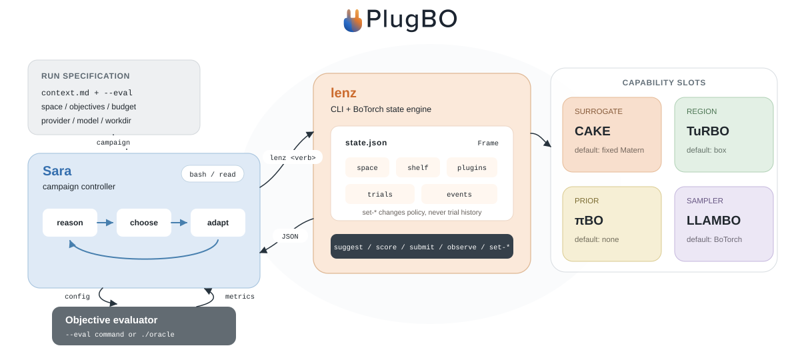

# Architecture

Sara, lenz, and the BO methods are the same kind of piece: modules on one
control plane.

- **Sara** is the host. It has two tools, `bash` and `read`, and reasons
  over trial data, surrogate diagnostics, and natural-language context to
  decide how to search next.
- **lenz** is the shared tool surface, a [BoTorch](https://botorch.org/)
  backend that owns the trial log and posterior computation. It is
  independently usable without an agent (see the
  [vanilla loop](../getting-started/quickstart.md#vanilla-loop-no-llm)).
- **BO methods** (CAKE, TuRBO, πBO, LLAMBO) occupy slots on lenz: surrogate,
  region, prior, sampler.

This is analogous to [MCP](https://modelcontextprotocol.io/): Sara is the
host, lenz is the shared tool surface, and a BO method registers extra verbs
there the way an MCP server registers tools. The agent itself stays fixed —
only the surrogate, region, prior, or sampler changes as methods are plugged
in.

## Why keep the agent fixed?

Restricting Sara to `bash` and `read` — instead of growing a bespoke tool for
every new BO method — means:

- New capability is added as a `lenz` verb, not a second agent or a new tool
  schema Sara has to be taught.
- Method state stays inside `lenz`'s `state.json` (`frame.plugins`), not
  scattered across the agent's context.
- Reconfiguring a slot never discards trials — the trial log and posterior
  are lenz's responsibility, independent of which plugins are active.

## Where state lives

- The trial log, posterior, and objectives live in `lenz`'s `state.json`.
- Each active plugin stores its own blob under `state.json`'s `plugins` key.
- Sara's conversation only ever sees what `lenz` and `read` return — plugin
  internals (e.g. CAKE's kernel-evolution trace) are not part of the agent's
  context unless a command surfaces them.

See [Plugins](plugins.md) for the slot model in detail, and the
[plugin reference](../reference/cake.md) pages for what each specific method
does.
