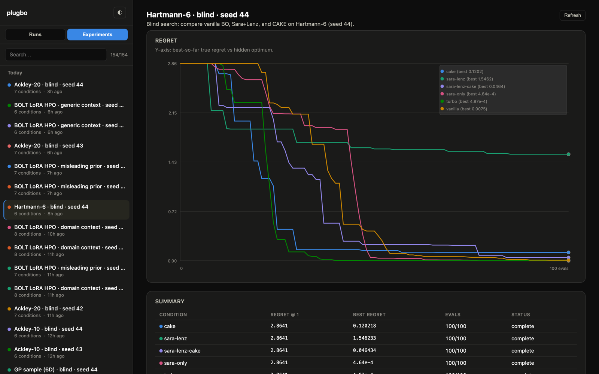

# Run viewer

`plugbo-viz` is a local UI over run logs. Open a run to read the trial table,
the agent trace, tool-use over the run, and — when CAKE is on — the kernel
population.

```bash
plugbo-viz
plugbo-viz --root ./results/logs --port 9000
```

Search the sidebar, tick several runs to overlay them, or switch to
**Experiments** to put every condition in a group on one regret chart.



## Merged view

For a single merged regret chart across all conditions:

```bash
python3 -m viz.merged_server
```

or use the **Experiments** tab in `plugbo-viz` to compare multiple runs
directly.
