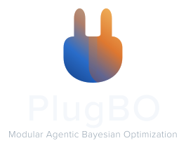

<p align="center">
  
  
</p>

[:fontawesome-brands-github: GitHub](https://github.com/richardcsuwandi/plugbo){ .md-button }
[:material-book-open-page-variant: Blog post](https://richardcsuwandi.github.io/blog/2026/plug-bo/){ .md-button }

Bayesian optimization (BO) uses a probabilistic surrogate to choose each
evaluation, but its overall search strategy is usually fixed in advance.
**Agentic BO** places an LLM agent at the center of the loop: it reviews trial
data, surrogate diagnostics, and natural-language context, then decides how to
search next. As evidence accumulates, the agent can query or override backend
suggestions and revise the surrogate, acquisition function, search bounds,
objectives, or constraints.[^1]

Meta's *Agentic Bayesian Optimization through Surrogate-Augmented
Autoresearch* instantiates that idea as **Sara**, an LLM agent, calling
**lenz**, a [BoTorch](https://botorch.org/) backend that owns the trial log
and posterior computation.[^6] PlugBO keeps that agent and backend, then
turns the backend into a plugin surface: surrogate, region, prior, and
sampler are slots. Existing and new BO modules wrap as `lenz` verbs the agent
can enable, inspect, or override.

The arrangement is analogous to [MCP](https://modelcontextprotocol.io/): Sara
is the host, with only `bash` and `read`, and lenz is the shared tool surface.
A BO method registers extra verbs there the way an MCP server registers
tools, so the agent stays fixed while the surrogate, region, prior, or
sampler can be swapped in as a plugin.

!!! note
    PlugBO is not an official implementation of Meta's agentic BO paper.
    What is new here is the plugin protocol, together with new experiments
    and results. See [References](about/references.md) for the full source
    list.

## Why PlugBO?

- **Modular and extensible.** The surrogate, region, prior, and sampler are
  slots on a shared BoTorch backend — see [Architecture](concepts/architecture.md).
- **An LLM agent in a live BO loop.** The agent can inspect trials, query the
  posterior, and reconfigure slots mid-run, while BoTorch retains the trial
  log and posterior.
- **A shared tool-surface for future BO methods**, analogous to MCP. A
  method registers extra `lenz` verbs the way an MCP server registers tools —
  see [Plugins](concepts/plugins.md).

## Quickstart

```bash
git clone https://github.com/richardcsuwandi/plugbo.git
cd plugbo
pip install -e .
```

```bash
lenz create --state ./state.json \
  --space '{"x1":{"kind":"range","lower":-5,"upper":10},"x2":{"kind":"range","lower":0,"upper":15}}' \
  --objectives '{"y":"minimize"}' \
  --acqf noisy_logei

lenz suggest --state ./state.json
lenz submit --state ./state.json --config '{"x1":1.0,"x2":2.0}' --metrics '{"y":12.3}'
lenz incumbent --state ./state.json
```

Continue with the full [installation guide](getting-started/installation.md)
and [quickstart walkthrough](getting-started/quickstart.md), including
running Sara as the agent-in-the-loop.

## Modules

| Module | Role | Default | Occupant | Commands |
|---|---|---|---|---|
| `sara` | search agent | — | — | `sara run` |
| `lenz` | trial log, posterior, acquisition | BoTorch loop | — | `create`, `suggest`, `submit`, `incumbent` |
| Surrogate | GP | fixed Matérn | [**CAKE**](reference/cake.md)[^2] | `set-surrogate`, `evolve-kernels`, `kernel-population` |
| Region | search bounds | box | [**TuRBO**](reference/turbo.md)[^3] | `set-region`, `set-bounds`, `turbo status` |
| Prior | belief | none | [**πBO**](reference/pibo.md)[^4] | `set-belief` |
| Sampler | candidates | BoTorch | [**LLAMBO**](reference/llambo.md)[^5] | `set-sampler`, `llambo sample` |

[^1]: Brunzema et al. *Agentic Bayesian Optimization through Surrogate-Augmented Autoresearch.* arXiv:2608.00316, 2026.
[^2]: Suwandi et al. *Adaptive Kernel Design for Bayesian Optimization Is a Piece of CAKE with LLMs.* NeurIPS 2025.
[^3]: Eriksson et al. *Scalable Global Optimization via Local Bayesian Optimization.* NeurIPS 2019.
[^4]: Hvarfner et al. *πBO: Augmenting Acquisition Functions with User Beliefs for Bayesian Optimization.* ICLR 2022.
[^5]: Liu et al. *Large Language Models to Enhance Bayesian Optimization.* ICLR 2024.
[^6]: Balandat et al. *BoTorch: A Framework for Efficient Monte-Carlo Bayesian Optimization.* NeurIPS 2020.
